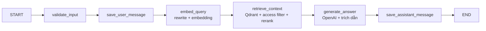

# Kiến trúc hệ thống — Trung Tâm Tri Thức AI (AI20K)

Tài liệu mô tả kiến trúc của **Trung Tâm Tri Thức AI** — nền tảng hỏi đáp tài liệu
học vụ bằng RAG (Retrieval-Augmented Generation) cho **Giảng viên** và **Sinh viên**.
Tài khoản quản trị chỉ phục vụ vận hành/dev: đăng nhập console là toàn quyền dữ liệu.

## 1. Tổng quan

Hệ thống gồm một SPA frontend (React + Vite) giao tiếp với backend **FastAPI** qua
REST + SSE. Backend điều phối một **LangGraph RAG agent** truy hồi ngữ cảnh từ
**Qdrant** (vector store) và sinh câu trả lời bằng **OpenAI**. Tài liệu gốc được lưu
trên **Cloudflare R2**, metadata/người dùng/hội thoại lưu ở **PostgreSQL**, và các
tác vụ nặng (trích xuất + nhúng tài liệu) được đẩy qua hàng đợi **Redis + worker**.
**NGINX** đứng trước làm reverse proxy, phục vụ FE tĩnh và proxy API/SSE.


> Sơ đồ trên thể hiện 7 luồng chính: Xác thực & phân quyền, Upload tài liệu,
> RAG Pipeline (nạp dữ liệu), Chat AI RAG (hỏi đáp), Quản trị, Luồng hệ thống
> tổng thể và DevOps/CI-CD.

## 2. Sơ đồ luồng hệ thống

```text
CLIENT ─▶ NGINX ─▶ Frontend (React/Vite SPA) ─▶ FastAPI ─┬─▶ Cloudflare R2 (tài liệu gốc)
                                    (JWT access+refresh)   ├─▶ PostgreSQL (metadata + auth + hội thoại)
                                                           ├─▶ Redis ─▶ Worker (arq) — xử lý tài liệu nền
                                                           ├─▶ Qdrant (vector database)
                                                           └─▶ OpenAI (LLM + embedding)
```

> Ghi chú ánh xạ sơ đồ ↔ hiện thực: trong sơ đồ ghi "Next.js" và "celery worker"
> như lựa chọn tham chiếu; bản hiện thực dùng **React + Vite** cho frontend và
> **arq** (trên Redis) cho worker. LLM dùng **họ GPT-4o** (mặc định `gpt-4o-mini`,
> cấu hình qua `MODEL_NAME`).

## 3. Thành phần

### 3.1. Frontend — React (Vite) SPA
- **Vai trò sản phẩm:** giao diện `lecturer` / `student`; khu `admin` chỉ vận hành nội bộ.
  Tổ chức theo feature (`frontend/src/features/*`).
- **Tính năng chính:** đăng nhập JWT, Chat AI (streaming SSE + lịch sử hội thoại),
  quản lý tài liệu (giảng viên upload/list/xóa/tải bản gốc), kho tài liệu & hạn mức chat
  (sinh viên), dashboard số liệu realtime.
- **Giao tiếp:** một `axios` instance dùng chung tự gắn `Authorization: Bearer`;
  chat streaming gọi `fetch` tới `/api/v1/chat/stream` (Server-Sent Events).

### 3.2. Backend — FastAPI (kiến trúc phân tầng)
- **Tầng:** `routes` → `controllers` (logic theo domain) → `repositories` → `db`
  (SQLAlchemy async). `core/security` + `api/dependencies` lo JWT & RBAC.
- **Xác thực:** JWT (python-jose, HS256) + bcrypt; `get_current_user` giải mã token,
  `require_roles(...)` ép quyền theo vai trò.
- **API chính:** `/auth/*`, `/users`, `/documents/*`, `/students`, `/exams`,
  `/conversations/*`, `/stats/overview`, `/chat` & `/chat/stream`.

### 3.3. AI Agent — LangGraph RAG
- **Kiểu agent:** pipeline tuần tự, các node *soft-fail* (lỗi một node không làm sập
  cả luồng) — `src/agents/`.
- **State:** `query`, `conversation_id`, `user_id`, `user_role`, `top_k`,
  `search_query`, `history`, `retrieved_chunks`, `sources`, `response`, `error`.
- **Luồng node:**



- **Kỹ thuật RAG:** viết lại truy vấn theo lịch sử (contextualize), lọc truy hồi theo
  quyền xem tài liệu (`build_access_filter`: student→school; lecturer→school + tài
  liệu cá nhân; admin→tất cả), hybrid rerank (dense + BM25 RRF), ngưỡng điểm
  `rag_min_score` chống bịa, lọc nguồn chỉ giữ trích dẫn `[n]` thực sự xuất hiện.
- **Streaming:** SSE phát sự kiện `sources` → `token` (lặp) → `done`/`error`.

### 3.4. RAG Pipeline (nạp dữ liệu)
`Knowledge Base (PDF/DOCX/PPTX)` → **Convert to Markdown** (docling) → **Clean Data**
→ **Chunking** (~900 token / overlap 120) → **Embedding** (`text-embedding-3-small`,
1536 chiều) → **Qdrant**. Pipeline *idempotent* (bỏ qua tài liệu không đổi, tự dọn
điểm mồ côi). Mỗi chunk mang payload `scope`, `owner_id`, `category` để lọc theo quyền.

### 3.5. Cơ sở dữ liệu — PostgreSQL
- **Bảng chính:** `roles`, `users`, `documents`, `document_chunks`, `conversations`,
  `messages`, `citations`, `agent_runs`, `students`, `exams`.
- **Migrations:** Alembic (bảng mới tự tạo qua `init_db`/`create_all` ở môi trường dev).

### 3.6. Vector Store — Qdrant
- Collection cosine 1536 chiều; payload index cho `document_id`, `scope`, `owner_id`.
- Phục vụ truy hồi top-K theo ngữ cảnh + lọc quyền truy cập tài liệu.

### 3.7. Object Storage — Cloudflare R2
- Lưu **tài liệu gốc** (S3-compatible qua boto3): key `documents/<owner_id>/<file>`.
- Hỗ trợ URL tải xuống tạm thời (presigned). *Graceful*: nếu chưa cấu hình R2 thì
  tự no-op, hệ thống vẫn chạy với file local.

### 3.8. Message Queue — Redis + Worker (arq)
- Upload tài liệu có thể **đẩy job vào hàng đợi** (`INGEST_ASYNC=true`): tạo bản ghi
  `queued`, trả response ngay; **worker** (`python -m src.worker`) chạy docling +
  embedding + upsert Qdrant ở nền. Nếu Redis không sẵn sàng → tự fallback xử lý inline.

### 3.9. NGINX — Reverse Proxy
- Phục vụ FE build tĩnh (SPA fallback), proxy `/api/` + `/health` → FastAPI:8000,
  **tắt buffering** cho SSE `/chat/stream`, `client_max_body_size 50m` cho upload.

## 4. Các luồng dữ liệu chính

### 4.1. Xác thực & phân quyền
1. User (admin/lecturer/student) đăng nhập qua FE → `POST /auth/login`.
2. FastAPI xác thực với PostgreSQL, cấp **JWT access** (ngắn hạn) + thông tin vai trò.
3. Mọi request gắn `Bearer token`; `require_roles` kiểm tra quyền theo từng endpoint.

### 4.2. Upload & nạp tài liệu
1. Giảng viên/Admin upload file → lưu local tạm + **đẩy bản gốc lên R2** + ghi metadata
   (`scope`, `category`, `owner_id`) vào PostgreSQL.
2. Tài liệu được xử lý (inline hoặc qua **Redis + worker**): Markdown → clean → chunk →
   embedding → **Qdrant**.

### 4.3. Hỏi đáp RAG (Chat)
1. Người dùng gửi câu hỏi → FastAPI → LangGraph agent.
2. Viết lại truy vấn → **embedding query** → **Vector Search (Qdrant)** lọc theo quyền →
   lấy **Top-K context** → **rerank**.
3. **LLM (GPT-4o family)** sinh câu trả lời kèm trích dẫn → stream về client → lưu
   hội thoại + tin nhắn vào PostgreSQL (tự đặt tiêu đề theo câu hỏi đầu).

### 4.4. Dashboard realtime
- `GET /stats/overview` đếm trực tiếp từ DB theo vai trò (người dùng/tài liệu/hội
  thoại/lượt hỏi cho admin nội bộ; tài liệu/hội thoại cho giảng viên;
  tài liệu khả dụng/hội thoại cho sinh viên) + danh sách tài liệu mới nhất.

## 5. DevOps & CI/CD

```text
Github (push code)
   └─▶ CI · Build & Test:  Install deps → Lint/Format → Unit tests → Security scan
          └─▶ Build Docker images → Container Registry
                 └─▶ CD · Deploy:  Pull latest images → Run migrations → Restart services
```

- Hạ tầng phụ trợ khởi động bằng Docker Compose (xem `deploy/`): Redis (queue) và
  cấu hình NGINX (`deploy/nginx/ai20k.conf`).

## 6. Bảo mật
- API key/secret để trong `.env` (không commit).
- JWT HS256 + bcrypt; RBAC theo vai trò (`admin`/`lecturer`/`student`).
- Lọc quyền truy hồi tài liệu ở tầng vector (mỗi vai trò chỉ thấy tài liệu được phép).
- Validate input bằng Pydantic; CORS cấu hình theo domain frontend.
- Quyền sở hữu: giảng viên chỉ sửa/xóa tài liệu và hội thoại của chính mình; admin nội bộ toàn quyền kho dùng chung.

## 7. Tech stack & quyết định thiết kế

| Hạng mục | Lựa chọn | Lý do |
|----------|----------|-------|
| Frontend | React + Vite (SPA) | Nhẹ, build nhanh, tách feature rõ ràng |
| Backend | FastAPI (async) | Hiệu năng async, auto-docs, type-safe |
| AI Agent | LangGraph | Quản lý state linh hoạt, node soft-fail |
| LLM / Embedding | OpenAI GPT-4o family / text-embedding-3-small | Chất lượng cao, chi phí hợp lý |
| Vector store | Qdrant | Lọc payload mạnh, phù hợp RBAC truy hồi |
| Database | PostgreSQL | Quan hệ, ổn định cho metadata/auth/hội thoại |
| Object storage | Cloudflare R2 | S3-compatible, chi phí thấp cho tài liệu gốc |
| Queue | Redis + arq | Async, hợp với codebase asyncio |
| Reverse proxy | NGINX | Phục vụ SPA + proxy API/SSE, giới hạn upload |
| Auth | JWT + bcrypt | Stateless, chuẩn phổ biến |
