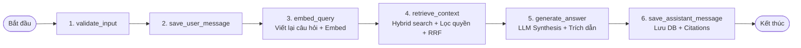

# StudyMind — Nền Tảng Học Tập & Trợ Lý Học Vụ Thông Minh Ứng Dụng AI

[](https://fastapi.tiangolo.com)
[](https://github.com/langchain-ai/langgraph)
[](https://qdrant.tech)
[](https://react.dev)
[](https://www.postgresql.org)
[](https://payos.vn)
[](https://opensource.org/licenses/MIT)

**StudyMind** (Dự án **EXE201**) là nền tảng học tập thông minh và trợ lý học vụ toàn diện ứng dụng công nghệ **AI Agent** và **RAG (Retrieval-Augmented Generation)** tiên tiến. Hệ thống được xây dựng nhằm giải quyết triệt để tình trạng phân mảnh tài liệu học tập, hỗ trợ sinh viên tự học chủ động (Active Learning), giúp giảng viên quản lý lớp học - đề thi hiệu quả và cung cấp bảng điều khiển quản trị tập trung cho nhà trường.

Hệ thống cam kết câu trả lời **trung thực, có dẫn chứng trích dẫn nguồn cụ thể (tên tài liệu, trang, đoạn trích, liên kết phút video)**, hoàn toàn **nói không với bịa đặt (anti-hallucination)** và bảo vệ bản quyền tri thức theo phân quyền **RBAC**.

---

## 📑 Mục Lục

1. [Điểm Nổi Bật & Tính Năng Cốt Lõi](#-điểm-nổi-bật--tính-năng-cốt-lõi)
2. [Các Luồng Nghiệp Vụ Chính (Main Flows)](#-các-luồng-nghiệp-vụ-chính-main-flows)
3. [Kiến Trúc Hệ Thống (Architecture)](#-kiến-trúc-hệ-thống-architecture)
4. [Khởi Chạy Nhanh (Quick Start)](#-khởi-chạy-nhanh-quick-start)
5. [Tài Khoản Thử Nghiệm (Demo Accounts)](#-tài-khoản-thử-nghiệm-demo-accounts)
6. [Cấu Trúc Thư Mục Dự Án](#-cấu-trúc-thư-mục-dự-án)
7. [Danh Mục API Chi Tiết](#-danh-mục-api-chi-tiết)
8. [Pipeline Xử Lý Dữ Liệu & Ingest](#-pipeline-xử-lý-dữ-liệu--ingest)
9. [Công Nghệ Sử Dụng (Tech Stack)](#-công-nghệ-sử-dụng-tech-stack)
10. [Kiểm Thử & Đánh Giá Chất Lượng (Testing & Evaluation)](#-kiểm-thử--đánh-giá-chất-lượng-testing--evaluation)
11. [Hướng Dẫn Triển Khai (Deployment)](#-hướng-dẫn-triển-khai-deployment)
12. [Đội Ngũ Thực Hiện & Đồ Án](#-đội-ngũ-thực-hiện--đồ-án)

---

## 🌟 Điểm Nổi Bật & Tính Năng Cốt Lõi

### 1. Trợ Lý AI RAG Học Vụ & Môn Học (Academic RAG Chatbot)
- **Truy hồi có căn cứ (Grounded Q&A)**: Chỉ trả lời dựa trên kho tài liệu đã được kiểm duyệt của nhà trường hoặc tài liệu giảng viên tải lên. Tuyệt đối từ chối trả lời ngoài phạm vi thay vì phỏng đoán hay bịa đặt.
- **Trích dẫn nguồn trực quan (Exact Citations)**: Mỗi phát biểu kèm số trích dẫn `[n]`, bấm vào xem chi tiết: tên tài liệu, số trang, đoạn trích thực tế và điểm số tương đồng ngữ nghĩa.
- **Trải nghiệm hội thoại thời gian thực**:
  - Truyền phát câu trả lời dạng gõ chữ liên tục (**Streaming qua SSE** - Server-Sent Events).
  - Tự động viết lại truy vấn nối tiếp (**Contextual Query Rewriting**) dựa theo ngữ cảnh lịch sử chat.
  - Render Markdown đầy đủ: bảng biểu, khối mã lập trình, in đậm, công thức.
  - Tự động điều chỉnh ngôn ngữ đầu ra khớp chuẩn xác với ngôn ngữ câu hỏi của người dùng.

### 2. Không Gian Tự Học Chủ Động (AI Study Aid & Active Recall)
- **Thẻ ghi nhớ Flashcards 3D**: AI tự động trích xuất các khái niệm, định nghĩa và công thức cốt lõi từ bài giảng thành bộ thẻ lật 3D tương tác, hỗ trợ phương pháp ghi nhớ ngắt quãng (Spaced Repetition).
- **Trắc nghiệm ôn tập (AI Quizzes & Word Import)**:
  - Tự động tạo bài thi trắc nghiệm khách quan 4 phương án kèm đáp án và giải thích chi tiết từ giáo trình.
  - **Nhập đề thi từ file Word (.docx) thông minh**: Bộ bóc tách chuyên dụng nhận diện tự động câu hỏi, các đáp án `A/B/C/D`, đáp án đúng qua ký hiệu `*`, gạch chân, chữ đỏ hoặc bảng đáp án cuối tài liệu. Có sẵn file Word mẫu để tải về.
- **Đánh giá năng lực AI & Lộ trình học cá nhân hóa (Personalized Learning Roadmap)**:
  - Sau mỗi lượt làm bài kiểm tra, AI phân tích ma trận điểm mạnh, điểm yếu và các lỗ hổng kiến thức cốt lõi.
  - Tự động thiết lập lộ trình ôn tập từng bước: chỉ định rõ tài liệu cần đọc lại, bộ flashcard cần luyện tập và bài kiểm tra bù kiến thức.

### 3. Quản Lý Lớp Học & Học Vụ (Classrooms & Academic Hub)
- **Mô hình Lớp học (Classrooms)**: Giảng viên mở lớp, tạo **mã mời (Class Code)** để sinh viên tham gia. Giảng viên phân phối tài nguyên, bài giảng riêng biệt cho từng lớp học.
- **Lịch thi & Ôn tập (Exam Schedules)**: Quản lý lịch thi (môn học, phòng thi, thời gian, thời lượng) và liên kết trực tiếp với các tài liệu ôn tập trọng tâm trong thư viện.
- **Quản lý danh sách sinh viên**: Theo dõi thông tin sinh viên, lịch sử nộp bài và kết quả kiểm tra theo từng lớp.

### 4. Pipeline Dữ Liệu Đa Phương Thức & Idempotent
- **Hỗ trợ đa định dạng tài liệu**: Xử lý tệp PDF, Word (`.docx`), PowerPoint (`.pptx`), văn bản thuần (`.txt`, `.md`).
- **Nạp liên kết Web & Video YouTube**:
  - Bóc tách nội dung bài viết từ các URL học thuật.
  - Trích xuất phụ đề (transcript) video YouTube kèm **mốc thời gian (timestamp)**, cho phép click xem đúng phút của video trong trích dẫn.
- **Idempotent theo mã băm SHA-256**: Kiểm tra mã băm tài liệu, không embed lại tài liệu cũ không đổi; tự động dọn sạch các vector point mồ côi trên Qdrant khi tài liệu bị gỡ.
- **Xử lý nền linh hoạt**: Hỗ trợ xử lý bất đồng bộ qua Redis + arq worker để người dùng không phải chờ đợi lâu khi nạp tài liệu lớn.

### 5. Xác Thực Đa Kênh & Phân Quyền Đa Tầng (RBAC)
- **3 vai trò chuẩn mực**: `student` (sinh viên), `lecturer` (giảng viên), và `admin` (quản trị viên vận hành).
- **Đăng nhập linh hoạt**: Đăng nhập bằng `username` hoặc `email`, tích hợp **Google OAuth 2.0 (Gmail)** bằng một chạm.
- **Quên mật khẩu an toàn**: Quy trình xác minh OTP 6 số qua email (tích hợp Brevo HTTP API cổng 443 và fallback SMTP).
- **Phân vùng tài liệu**: Phạm vi toàn trường (`school`) hoặc cá nhân/lớp học (`personal`/`classroom`). Bộ lọc vector đảm bảo sinh viên chỉ truy xuất tài liệu hợp lệ theo quyền.

### 6. Cổng Thanh Toán Tự Động & Nâng Cấp Gói (Billing & Pro Plans)
- **Tích hợp VietQR (PayOS)** quét mã thanh toán ngân hàng chuyển khoản tự động tức thì.
- **Tích hợp VNPay Sandbox** với quy trình xác thực chữ ký số an toàn (IPN & Browser Return).
- **Các gói dịch vụ minh bạch**:
  - **Gói Free**: Hạn mức 200,000 token/ngày, trải nghiệm toàn bộ tính năng học tập cơ bản.
  - **Gói Sinh Viên Pro (39,000đ/tháng)**: Mở rộng hạn mức lên 900,000 token/ngày, ưu tiên xử lý AI.
  - **Gói Giảng Viên (129,000đ/tháng)**: Mở rộng tạo đến 50 lớp học và không giới hạn lưu trữ tài liệu môn học.

---

## 🔄 Các Luồng Nghiệp Vụ Chính (Main Flows)

StudyMind vận hành dựa trên 6 luồng logic khép kín:

```mermaid
flowchart TD
    subgraph AuthFlow["1. Luồng Xác Thực & Phân Quyền"]
        A1[Người dùng] -->|Đăng nhập Username/Email hoặc Google OAuth| A2[FastAPI Auth Controller]
        A2 -->|Verify mật khẩu / Google Token| A3[Cấp JWT Access Token]
        A3 -->|Điều hướng theo Role| A4{Vai trò?}
        A4 -->|Student| A5[/student/dashboard]
        A4 -->|Lecturer| A6[/lecturer/dashboard]
        A4 -->|Admin| A7[/admin/dashboard]
    end

    subgraph IngestionFlow["2. Luồng Nạp & Xử Lý Tri Thức"]
        B1[Tài liệu: PDF/DOCX/PPTX/TXT/Web/YouTube] -->|Upload / Nhập Link| B2[Ingestion Service]
        B2 -->|Lưu bản gốc| B3[(Cloudflare R2)]
        B2 -->|Tách chữ & Làm sạch| B4[Chunking ~900 tokens]
        B4 -->|text-embedding-3-small| B5[Embeddings 1536d]
        B5 -->|Upsert kèm Metadata & RBAC| B6[(Qdrant Vector DB)]
        B2 -->|Ghi Metadata & SHA-256| B7[(PostgreSQL)]
    end

    subgraph ChatFlow["3. Luồng Hỏi Đáp AI RAG Thông Minh"]
        C1[Câu hỏi của người dùng] -->|Gửi tới /chat/stream| C2[LangGraph Agent]
        C2 -->|Rewrite query theo lịch sử| C3[Contextualized Query]
        C3 -->|Hybrid Search| C4[Dense Qdrant + Sparse BM25]
        C4 -->|Hợp nhất & Lọc RBAC| C5[RRF Reranking]
        C5 -->|Kiểm tra ngưỡng rag_min_score| C6{Có đủ căn cứ?}
        C6 -->|Không| C7[Từ chối trả lời lịch sự]
        C6 -->|Có| C8[OpenAI GPT-4o-mini]
        C8 -->|Streaming SSE| C9[Hiển thị câu trả lời + Trích dẫn [n]]
        C9 -->|Lưu tin nhắn & Citations| B7
    end

    subgraph StudyFlow["4. Luồng Tự Học & Đánh Giá Năng Lực"]
        D1[Tài liệu môn học] -->|AI Prompt / Import DOCX| D2[Flashcards & Quizzes]
        D2 -->|Sinh viên làm bài| D3[Chấm điểm tức thì]
        D3 -->|Submit bài làm| D4[AI Competency Evaluator]
        D4 -->|Phân tích chuyên sâu| D5[Điểm mạnh + Điểm yếu + Lỗ hổng]
        D5 -->|Sinh lộ trình| D6[Personalized Study Roadmap]
    end
```

---

## 🏛 Kiến Trúc Hệ Thống (Architecture)

### Sơ Đồ Thành Phần Hệ Thống

```text
[ CLIENT BROWSER ]
       │
       ▼
 [ NGINX Reverse Proxy ] ─── Tĩnh (Static Build) ──▶ [ React 18 + Vite SPA ]
       │
       ▼ (Proxy API & SSE Stream)
 [ FastAPI Backend (Python 3.11+) ]
       ├── Core Security & JWT (RBAC: Admin / Lecturer / Student)
       ├── LangGraph Sequential RAG Agent (Query Rewrite → Retrieve → Generate)
       ├── Document Ingestion Pipeline (Docling / Lightweight Extractors)
       ├── Study Aid Service (Flashcards, DOCX Quiz Parser, AI Evaluator)
       └── Payment Service (PayOS VietQR & VNPay Sandbox)
       │
       ├──▶ [ PostgreSQL ] (Metadata, Users, Classrooms, Exams, Quizzes, History)
       ├──▶ [ Qdrant Vector Store ] (1536-dim Embeddings, Payload RBAC filtering)
       ├──▶ [ OpenAI API ] (GPT-4o-mini & text-embedding-3-small)
       ├──▶ [ Cloudflare R2 ] (S3-compatible Object Storage lưu trữ tệp gốc)
       ├──▶ [ Redis + arq worker ] (Xử lý hàng đợi nạp tài liệu nền)
       └──▶ [ Brevo HTTP / SMTP ] (Gửi email mã OTP khôi phục mật khẩu)
```

### LangGraph RAG Agent Pipeline

LangGraph agent được thiết kế theo mô hình tuần tự với cơ chế **soft-fail** (lỗi từng phần không làm sập toàn bộ luồng):



---

## 🚀 Khởi Chạy Nhanh (Quick Start)

### Yêu Cầu Môi Trường
- **Python**: Phiên bản `3.11` trở lên
- **Node.js**: Phiên bản `18.x` hoặc `20.x` trở lên (npm / pnpm)
- **Qdrant**: Cụm Qdrant Cloud hoặc Docker container chạy cổng `6333`
- **OpenAI API Key**: Có số dư khả dụng

---

### 1. Cài Đặt & Chạy Backend

```bash
# 1. Tạo và kích hoạt môi trường ảo
python -m venv .venv

# Trên Windows PowerShell:
.\.venv\Scripts\Activate.ps1
# Trên Linux / macOS:
# source .venv/bin/activate

# 2. Cài đặt các thư viện phụ thuộc
pip install -r requirements.txt

# 3. Tạo file cấu hình môi trường từ mẫu
cp .env.example .env

# Mở file .env và điền các khóa quan trọng:
# OPENAI_API_KEY=sk-...
# QDRANT_URL=...
# QDRANT_API_KEY=...
# DATABASE_URL=sqlite+aiosqlite:///./data/app.db (mặc định cho dev) hoặc PostgreSQL
# JWT_SECRET_KEY=...

# 4. Khởi tạo dữ liệu demo (tài khoản admin, lecturer, student mẫu)
python scripts/seed_demo.py

# 5. Nạp tài liệu mẫu vào cơ sở dữ liệu và Qdrant (chỉ cần chạy lần đầu)
python scripts/ingest.py

# 6. Khởi động máy chủ backend FastAPI
uvicorn src.main:app --reload --port 8000
```

> **Swagger UI kiểm thử API**: Truy cập trực tiếp tại `http://localhost:8000/docs`

---

### 2. Cài Đặt & Chạy Frontend

Mở một cửa sổ dòng lệnh mới:

```bash
# 1. Di chuyển vào thư mục frontend
cd frontend

# 2. Cài đặt các gói phụ thuộc
npm install

# 3. Tạo file cấu hình môi trường frontend
cp .env.example .env
# Kiểm tra biến VITE_API_URL=http://localhost:8000

# 4. Khởi chạy máy chủ phát triển Vite
npm run dev
```

> **Giao diện StudyMind Web App**: Mở trình duyệt tại `http://localhost:5173`

---

### 3. Khởi Chạy Nhanh Toàn Bộ Bằng Docker Compose

Hệ sinh thái StudyMind hỗ trợ khởi chạy toàn diện gồm: PostgreSQL + Redis + FastAPI Backend + Background Worker + Frontend qua Docker:

```bash
docker-compose up --build -d
```

---

## 👥 Tài Khoản Thử Nghiệm (Demo Accounts)

Hệ thống hỗ trợ đăng nhập linh hoạt bằng **Email** hoặc **Username**:

| Vai trò | Email Đăng Nhập | Username | Mật Khẩu | Quyền Hạn Chính |
| :--- | :--- | :--- | :--- | :--- |
| **Quản trị viên (Admin)** | `admin@ai20k.vn` | `admin` | `admin123` | Quản trị người dùng, cấp quyền Pro, re-index Vector DB, xem thống kê & chẩn đoán toàn hệ thống. |
| **Giảng viên (Lecturer)** | `lecturer@ai20k.vn` | `lecturer` | `lecturer123` | Mở lớp học, upload tài liệu môn học, tạo bài thi trắc nghiệm (AI & Word), quản lý lịch thi. |
| **Sinh viên (Student)** | `student@ai20k.vn` | `student` | `student123` | Chatbot RAG học vụ, góc tự học (Flashcards, Quizzes, Lộ trình AI), tham gia lớp học bằng mã. |

> Có thể tạo thêm tài khoản quản trị viên mới bằng lệnh:
> ```bash
> python scripts/create_admin.py --email admin2@studymind.vn --password MatKhauManh123 --name "Ban Quản Trị"
> ```

---

## 📂 Cấu Trúc Thư Mục Dự Án

```text
EXE201_product-persional/
├── src/                               # MÃ NGUỒN BACKEND (FastAPI)
│   ├── agents/                        # LangGraph RAG agent (graph, state, sequential nodes)
│   │   ├── nodes/                     # validate, save_message, embed, retrieve, generate
│   │   └── graph.py                   # Điểm lắp ráp workflow agent
│   ├── api/                           # Tầng giao diện API
│   │   ├── controllers/               # Business logic phân tách theo nghiệp vụ
│   │   │   ├── auth_controller.py     # Đăng nhập, Gmail OAuth, Quên mật khẩu OTP
│   │   │   ├── chat_controller.py     # Hỏi đáp RAG đồng bộ & Streaming SSE
│   │   │   ├── classroom_controller.py# Quản lý lớp học, mã tham gia, phân phối tài liệu
│   │   │   ├── document_controller.py # Upload, trích xuất metadata, link web/youtube
│   │   │   ├── study_aid_controller.py# Flashcard, Quiz generator, Import Word, AI Roadmap
│   │   │   ├── academic_controller.py # Quản lý sinh viên & Lịch thi (Exams)
│   │   │   ├── user_controller.py     # Quản lý người dùng, cấp/hủy Pro
│   │   │   └── stats_controller.py    # Thống kê, tín hiệu người dùng, phản hồi
│   │   ├── dependencies.py            # Middleware xác thực JWT, RBAC guards
│   │   └── routes.py                  # Định tuyến toàn bộ API endpoints hệ thống
│   ├── core/                          # Tiện ích cốt lõi (Bcrypt hashing, JWT encoder/decoder)
│   ├── db/                            # Cơ sở dữ liệu SQLAlchemy models, session, seed
│   ├── models/                        # Pydantic schemas (Request/Response contracts)
│   ├── repositories/                  # Tầng truy xuất dữ liệu (Data Access Layer)
│   ├── services/                      # Nghiệp vụ hạ tầng & AI RAG
│   │   ├── billing.py                 # Tích hợp PayOS VietQR & VNPay, đối soát gói cước
│   │   ├── study_aid.py               # Sinh Flashcard/Quiz, chấm điểm, phân tích lộ trình
│   │   ├── docx_quiz_parser.py        # Bộ bóc tách câu hỏi trắc nghiệm từ file Word
│   │   ├── data_pipeline.py           # Pipeline clean text, chunking và quản lý artifact
│   │   ├── retrieval.py               # Truy hồi hybrid (Qdrant Dense + BM25 + RRF)
│   │   ├── youtube.py                 # Bóc tách phụ đề video YouTube có gắn timestamp
│   │   ├── web_page.py                # Bóc tách nội dung bài viết từ liên kết trang web
│   │   ├── vector_store.py            # Wrapper tương tác với Qdrant Vector DB
│   │   ├── embeddings.py              # Dịch vụ sinh vector embedding
│   │   ├── llm.py                     # Cấu hình gọi các mô hình ngôn ngữ lớn
│   │   ├── object_storage.py          # Kết nối Cloudflare R2 (lưu bản gốc tài liệu)
│   │   └── email_service.py           # Gửi email OTP (hỗ trợ Brevo HTTP API & SMTP)
│   ├── config.py                      # Pydantic Settings đọc cấu hình từ .env
│   ├── main.py                        # Điểm khởi chạy FastAPI, CORS, Lifespan startup
│   └── worker.py                      # arq background worker nạp tài liệu nền
├── frontend/                          # MÃ NGUỒN FRONTEND (React 18 + Vite)
│   └── src/
│       ├── components/                # Thành phần UI dùng chung (Logo, Icons, Modal, Toast)
│       ├── features/                  # Phân rã giao diện theo Feature & Persona
│       │   ├── auth/                  # Trang Đăng nhập, Quên mật khẩu OTP, AuthContext
│       │   ├── student/               # Khu sinh viên: Dashboard, Chat RAG, Lớp học,
│       │   │                          # Góc học tập (StudyPage, Flashcards, Quiz, Roadmap)
│       │   ├── lecturer/              # Khu giảng viên: Lớp học, Quản lý tài liệu,
│       │   │                          # Soạn đề thi (AI & Word), Quản lý sinh viên, Lịch thi
│       │   ├── admin/                 # Khu quản trị: Bảng điều khiển, Quản lý tài khoản,
│       │   │                          # Quản lý kho tài liệu, Báo cáo & Phân tích hệ thống
│       │   └── theme/                 # Quản lý giao diện sáng/tối (Dark/Light mode)
│       ├── services/                  # Tầng giao tiếp HTTP axios client, chatStream SSE
│       └── routes/AppRoutes.jsx       # Quản lý định tuyến và điều hướng theo phân quyền
├── datasets/docs/                     # Kho tài liệu giáo trình & quy chế gốc
├── data/                              # Dữ liệu cục bộ (app.db, artifacts đã xử lý)
├── deploy/                            # Cấu hình NGINX reverse proxy và triển khai
├── eval/results/                      # Báo cáo đánh giá độ chuẩn xác RAG (Faithfulness/Relevancy)
├── scripts/                           # Kịch bản tự động hóa (ingest, seed, create_admin, eval)
├── tests/                             # Bộ kiểm thử tự động hóa pytest (~128 test cases)
├── docker-compose.yml                 # Khởi chạy full-stack Docker
├── Dockerfile                         # Multi-stage Docker build cho backend
└── render.yaml                        # Blueprint triển khai đồng bộ lên nền tảng Render
```

---

## 📡 Danh Mục API Chi Tiết

Mọi endpoint nghiệp vụ đều được tiền tố hóa bằng `/api/v1`. Các endpoint yêu cầu quyền đăng nhập cần kèm theo header:  
`Authorization: Bearer <access_token>`.

### 1. Xác Thực & Người Dùng (`/auth`, `/users`)

| Method | Endpoint | Quyền Hạn | Mô Tả Chức Năng |
| :--- | :--- | :--- | :--- |
| `POST` | `/api/v1/auth/login` | Công khai | Đăng nhập bằng username/email + mật khẩu → Nhận JWT token |
| `POST` | `/api/v1/auth/gmail-login` | Công khai | Đăng nhập tức thì bằng Google OAuth ID Token |
| `POST` | `/api/v1/auth/forgot-password`| Công khai | Yêu cầu gửi mã OTP 6 số qua email để khôi phục mật khẩu |
| `POST` | `/api/v1/auth/verify-otp` | Công khai | Xác minh tính hợp lệ của mã OTP |
| `POST` | `/api/v1/auth/reset-password` | Công khai | Thiết lập mật khẩu mới sau khi xác thực OTP thành công |
| `GET` | `/api/v1/users/me` | Đã đăng nhập | Lấy thông tin tài khoản hiện tại |
| `PUT` | `/api/v1/users/me` | Đã đăng nhập | Cập nhật hồ sơ cá nhân |
| `PUT` | `/api/v1/users/me/password` | Đã đăng nhập | Đổi mật khẩu tài khoản |
| `GET` | `/api/v1/users` | Admin | Lấy danh sách toàn bộ người dùng hệ thống |
| `POST` | `/api/v1/create-user` | Admin | Tạo người dùng mới thủ công |
| `POST` | `/api/v1/users/{id}/grant-pro`| Admin | Kích hoạt đặc quyền Pro cho người dùng |
| `POST` | `/api/v1/users/{id}/revoke-pro`| Admin | Hủy bỏ đặc quyền Pro của người dùng |

### 2. Trợ Lý AI RAG & Hội Thoại (`/chat`, `/conversations`)

| Method | Endpoint | Quyền Hạn | Mô Tả Chức Năng |
| :--- | :--- | :--- | :--- |
| `POST` | `/api/v1/chat/stream` | Đã đăng nhập | Hỏi đáp RAG streaming gõ chữ (SSE) kèm trích dẫn nguồn `[n]` |
| `POST` | `/api/v1/chat` | Đã đăng nhập | Hỏi đáp RAG đồng bộ (nhận toàn bộ kết quả một lần) |
| `GET` | `/api/v1/conversations` | Đã đăng nhập | Lấy danh sách các phiên hội thoại của người dùng |
| `GET` | `/api/v1/conversations/{id}/messages` | Chủ sở hữu / Admin | Lấy toàn bộ lịch sử tin nhắn và citations của hội thoại |
| `PUT` | `/api/v1/conversations/{id}` | Chủ sở hữu / Admin | Đổi tên tiêu đề cuộc hội thoại |
| `DELETE`| `/api/v1/conversations/{id}` | Chủ sở hữu / Admin | Xóa phiên hội thoại |
| `POST` | `/api/v1/chat/feedback` | Đã đăng nhập | Gửi đánh giá Thumbs Up/Down và nhận xét cho câu trả lời AI |
| `POST` | `/api/v1/chat/signal` | Đã đăng nhập | Ghi nhận tín hiệu tương tác (sao chép, lưu câu trả lời, retry) |

### 3. Quản Lý Tài Liệu & Tri Thức (`/documents`)

| Method | Endpoint | Quyền Hạn | Mô Tả Chức Năng |
| :--- | :--- | :--- | :--- |
| `POST` | `/api/v1/documents/upload` | Admin, Lecturer | Upload tài liệu (PDF, Word, PPTX, TXT, MD) và nạp vào RAG |
| `POST` | `/api/v1/documents/link` | Admin, Lecturer | Nạp nội dung từ liên kết Web hoặc Video YouTube (có timestamp) |
| `POST` | `/api/v1/documents/suggest-metadata` | Admin, Lecturer | AI phân tích tệp và gợi ý tiêu đề, môn học, phân loại tự động |
| `GET` | `/api/v1/documents/available` | Đã đăng nhập | Danh sách tài liệu được phép truy cập theo phân quyền |
| `GET` | `/api/v1/documents/mine` | Admin, Lecturer | Danh sách tài liệu do tài khoản hiện tại tải lên |
| `GET` | `/api/v1/documents/{id}/view` | Đã đăng nhập | Xem trước nội dung tài liệu trực tiếp trên web |
| `GET` | `/api/v1/documents/{id}/download` | Admin, Lecturer | Lấy đường dẫn presigned URL tải bản gốc từ Cloudflare R2 |
| `PUT` / `DELETE` | `/api/v1/documents/{id}` | Admin, Lecturer | Cập nhật thông tin hoặc xóa tài liệu khỏi hệ thống |

### 4. Không Gian Lớp Học (`/classrooms`)

| Method | Endpoint | Quyền Hạn | Mô Tả Chức Năng |
| :--- | :--- | :--- | :--- |
| `GET` | `/api/v1/classrooms` | Admin, Lecturer | Danh sách lớp học do giảng viên quản lý |
| `POST` | `/api/v1/classrooms` | Admin, Lecturer | Tạo không gian lớp học mới (tự động tạo mã mời) |
| `GET` | `/api/v1/classrooms/enrolled` | Student | Danh sách các lớp học mà sinh viên đã tham gia |
| `POST` | `/api/v1/classrooms/join` | Student | Tham gia vào lớp học bằng mã mời (Join Code) |
| `GET` | `/api/v1/classrooms/{id}/documents` | Thành viên lớp | Danh sách tài liệu bài giảng được phân phối trong lớp |
| `POST` | `/api/v1/classrooms/{id}/documents/upload`| Admin, Lecturer | Đăng tải tài liệu trực tiếp vào một lớp học cụ thể |
| `GET` | `/api/v1/classrooms/{id}/students` | Admin, Lecturer | Xem danh sách học viên trong lớp |
| `POST` | `/api/v1/classrooms/{id}/leave` | Student | Rời khỏi lớp học |

### 5. Góc Tự Học, Flashcards & Trắc Nghiệm (`/study-aid`, `/quizzes`)

| Method | Endpoint | Quyền Hạn | Mô Tả Chức Năng |
| :--- | :--- | :--- | :--- |
| `GET` | `/api/v1/documents/{id}/flashcards` | Đã đăng nhập | Lấy danh sách Flashcards của tài liệu |
| `POST` | `/api/v1/documents/{id}/flashcards/generate` | Đã đăng nhập | Yêu cầu AI tự động tạo bộ Flashcard từ nội dung tài liệu |
| `POST` | `/api/v1/documents/{id}/quizzes/generate` | Đã đăng nhập | Yêu cầu AI soạn đề thi trắc nghiệm khách quan từ tài liệu |
| `GET` | `/api/v1/quizzes/sample-template` | Công khai | Tải file Word (.docx) mẫu chuẩn cấu trúc để soạn đề thi |
| `POST` | `/api/v1/quizzes/parse-docx` | Admin, Lecturer | Đọc thử nghiệm file Word đề thi và hiển thị bản xem trước |
| `POST` | `/api/v1/quizzes/import-docx` | Admin, Lecturer | Nhập chính thức đề thi trắc nghiệm từ file Word vào hệ thống |
| `GET` | `/api/v1/quizzes/{id}` | Đã đăng nhập | Lấy nội dung đề thi trắc nghiệm để làm bài |
| `POST` | `/api/v1/quizzes/{id}/submit` | Đã đăng nhập | Nộp bài làm trắc nghiệm, chấm điểm tức thì và lưu kết quả |
| `GET` | `/api/v1/study-aid/my-attempts` | Đã đăng nhập | Lấy lịch sử tất cả các lần làm bài kiểm tra của sinh viên |
| `GET` | `/api/v1/study-aids/quiz-attempts/{attempt_id}/review` | Đã đăng nhập | Xem lại chi tiết từng câu làm đúng/sai kèm giải thích |
| `POST` | `/api/v1/study-aids/quiz-attempts/{attempt_id}/evaluation`| Đã đăng nhập | AI phân tích năng lực (Mạnh/Yếu) và lập lộ trình học tập |
| `GET` | `/api/v1/study-aids/my-evaluations` | Đã đăng nhập | Danh sách các báo cáo đánh giá năng lực AI đã tạo |

### 6. Cổng Thanh Toán & Gói Dịch Vụ (`/payments`, `/billing`)

| Method | Endpoint | Quyền Hạn | Mô Tả Chức Năng |
| :--- | :--- | :--- | :--- |
| `GET` | `/api/v1/billing/me` | Đã đăng nhập | Kiểm tra trạng thái gói cước và hạn mức token sử dụng trong ngày |
| `POST` | `/api/v1/payments/vnpay/create` | Student, Lecturer | Khởi tạo giao dịch thanh toán qua VietQR PayOS hoặc VNPay |
| `POST` | `/api/v1/payments/reconcile/{order_code}` | Student, Lecturer | Kiểm tra và đối soát trạng thái đơn thanh toán tức thì |
| `POST` | `/api/v1/payments/payos/webhook` | Webhook | Endpoint nhận thông báo thanh toán thành công tự động từ PayOS |
| `GET` | `/api/v1/payments/vnpay/return` | Browser Redirect | Điều hướng trở lại giao diện web sau khi thanh toán VNPay |
| `GET` | `/api/v1/payments/receipt/{order_code}` | Đã đăng nhập | Lấy thông tin hóa đơn / biên nhận chuyển khoản chi tiết |

---

## ⚙️ Pipeline Xử Lý Dữ Liệu & Ingest

Hệ thống cung cấp kịch bản quản lý tri thức thông minh, hỗ trợ chạy an toàn nhiều lần (**Idempotent**):

```bash
# 1. Ingest tài liệu thông minh (chỉ xử lý tệp mới hoặc tệp bị thay đổi nội dung)
python scripts/ingest.py

# 2. Ép buộc phân tích và embed lại toàn bộ kho tài liệu
python scripts/ingest.py --force

# 3. Xóa sạch Vector Collection trên Qdrant và nạp lại từ đầu
python scripts/ingest.py --reset

# 4. Chỉ chạy bộ bóc tách và phân đoạn chunk (kiểm tra trước, không đẩy lên Vector DB)
python -m src.services.data_pipeline
```

### Điểm Vượt Trội Của Pipeline:
- **Nhận diện SHA-256**: Không tốn chi phí gọi OpenAI Embeddings cho các tệp tin chưa từng thay đổi.
- **Tự dọn dẹp mồ côi (Orphan Cleanup)**: Khi một tài liệu bị xóa khỏi thư mục nguồn hoặc giao diện, hệ thống tự động gỡ bỏ các vector point liên quan trên Qdrant để đảm bảo không trả về thông tin đã cũ.
- **Cơ chế Chạy Nhẹ (Low Memory Mode)**: Khi cấu hình `USE_DOCLING=false`, hệ thống tự chuyển sang bộ trích xuất nhẹ (`pypdf`, `python-docx`, `python-pptx`), vận hành mượt mà trên các gói máy chủ đám mây bị hạn chế RAM (512MB - 1GB RAM) mà không lo lỗi tràn bộ nhớ (OOM).

---

## 🛠 Công Nghệ Sử Dụng (Tech Stack)

| Tầng Kiến Trúc | Công Nghệ Lựa Chọn | Lý Do Áp Dụng |
| :--- | :--- | :--- |
| **AI Orchestration** | LangGraph + LangChain | Quản lý stateful agent tuần tự, hỗ trợ soft-fail và dễ mở rộng các node RAG. |
| **Large Language Model** | OpenAI GPT-4o-mini | Cân bằng hoàn hảo giữa tốc độ phản hồi cực nhanh, chi phí tối ưu và suy luận chuẩn xác. |
| **Embeddings** | `text-embedding-3-small` | Vector embedding 1536 chiều với khả năng nắm bắt ngữ nghĩa tài liệu học thuật xuất sắc. |
| **Vector Store** | Qdrant (Cloud / Docker) | Cơ sở dữ liệu vector hiệu năng cao với bộ lọc payload đa thuộc tính (RBAC scope, owner). |
| **Retrieval Engine** | Hybrid: Dense + Sparse (BM25) | Hợp nhất bằng thuật toán RRF (Reciprocal Rank Fusion), chống bỏ sót từ khóa chuyên ngành. |
| **Backend Framework** | FastAPI + SQLAlchemy (Async) | Bất đồng bộ hoàn toàn (Async IO), tốc độ xử lý vượt trội, chuẩn hóa schema qua Pydantic. |
| **Frontend Framework** | React 18 + Vite | Giao diện hiện đại, tải trang tức thì, thiết kế hướng module (Feature-driven). |
| **Thanh Toán Tự Động** | PayOS (VietQR) & VNPay | Hỗ trợ chuyển khoản ngân hàng quét mã QR 24/7 và cổng thanh toán thẻ sandbox. |
| **Object Storage** | Cloudflare R2 (S3 API) | Lưu trữ bản gốc các tài liệu bài giảng dung lượng lớn, miễn phí băng thông tải về (Egress). |
| **Message Queue** | Redis + arq worker | Đẩy các tác vụ nạp tài liệu nặng chạy ngầm dưới nền, phản hồi ngay lập tức cho người dùng. |
| **Xác Thực & Bảo Mật** | JWT (HS256) + bcrypt + Google OAuth | Bảo mật chuẩn công nghiệp, mã hóa mật khẩu một chiều, hỗ trợ đăng nhập 1 chạm. |
| **DevOps & Cloud** | Docker, Docker Compose, NGINX | Triển khai container hóa linh hoạt, cấu hình Blueprint đồng bộ trên Render. |

---

## 🧪 Kiểm Thử & Đánh Giá Chất Lượng (Testing & Evaluation)

### 1. Kiểm Thử Đơn Vị & Tích Hợp (Automated Testing)
Dự án được bảo vệ bởi bộ kiểm thử tự động toàn diện (**22 file test**, hơn **128 ca kiểm thử**):

```bash
# Chạy toàn bộ bộ test
pytest

# Chạy có hiển thị chi tiết từng ca kiểm thử
pytest -v
```

**Phạm vi bao phủ**:
- Quy trình agent graph (kiểm tra khả năng soft-fail khi node lỗi).
- Các API endpoints, phân quyền RBAC và middleware bảo vệ token.
- Luồng đăng nhập Gmail và quy trình khôi phục mật khẩu qua mã OTP.
- Bộ bóc tách tài liệu, bộ parse đề thi Word (.docx) và thuật toán chunking.
- Tương tác cơ sở dữ liệu và mock client cho Qdrant / OpenAI.

### 2. Đánh Giá Độ Chuẩn Xác RAG (RAG Evaluation Harness)
Hệ thống sử dụng cơ chế **LLM-as-a-Judge** độc lập để đánh giá độ tin cậy của câu trả lời dựa trên tập câu hỏi chuẩn tại `datasets/docs/questions.jsonl`:

```bash
python scripts/evaluate_rag_sample.py
```

- **Faithfulness (Độ trung thực)**: **0.94 / 1.0** — Câu trả lời bám sát hoàn toàn thông tin có trong tài liệu, không bịa đặt thêm chi tiết bên ngoài.
- **Answer Relevancy (Độ phù hợp)**: **0.88 / 1.0** — Câu trả lời tập trung trực diện vào trọng tâm câu hỏi của người học.
- **Out-of-domain Rejection**: **100%** — Hệ thống tự động từ chối lịch sự các câu hỏi không liên quan đến dữ liệu trường học.

---

## 🚢 Hướng Dẫn Triển Khai (Deployment)

Chi tiết cấu hình xem tại [DEPLOY.md](DEPLOY.md).

### 1. Triển Khai Với Render (Blueprint)
Dự án đã tích hợp sẵn tệp cấu hình `render.yaml`. Khi liên kết repository với Render:
1. Render tự động tạo cụm dịch vụ: **FastAPI Backend (Docker)**, **React Frontend (Static Web)**, **PostgreSQL Managed Database**, và **Redis Instance**.
2. Đặt `SEED_DEMO=true` để tự động tạo tài khoản quản trị và giảng viên ban đầu.
3. Đặt `USE_DOCLING=false` trên các gói máy chủ cơ bản để tối ưu dung lượng RAM.
4. Cấu hình khóa `BREVO_API_KEY` để gửi mã xác thực email qua cổng 443 (tránh bị nhà cung cấp đám mây chặn cổng SMTP 587/465).

### 2. Cấu Hình Reverse Proxy NGINX
Trong môi trường production, NGINX được cấu hình làm cổng đón tiếp mặt trước:
- Tắt cơ chế đệm proxy (`proxy_buffering off`) cho endpoint `/api/v1/chat/stream` để đảm bảo sự kiện SSE được truyền tức thời đến trình duyệt người dùng.
- Nâng giới hạn tải lên `client_max_body_size 50m;` để giảng viên thoải mái upload các tài liệu bài giảng và slide PowerPoint lớn.

---

## 👨‍💻 Đội Ngũ Thực Hiện & Đồ Án

Dự án được xây dựng và hoàn thiện trong khuôn khổ môn học **EXE201**:

| Thành Viên | Vai Trò | Trách Nhiệm Chính |
| :--- | :--- | :--- |
| **Hoàng Văn Anh** | AI / Backend Lead | Thiết kế kiến trúc RAG Agent, Ingestion Pipeline, Cơ sở dữ liệu, Tích hợp thanh toán & Hạ tầng Cloud. |
| **Nguyễn Thành Lộc**| Frontend Lead | Xây dựng giao diện React 18, trải nghiệm Streaming Chat, Góc tự học (Flashcards/Quiz) & Tích hợp API. |
| **Phạm Tuyết Nga** | Product & QA | Quản lý kế hoạch dự án, phân tích nghiệp vụ người dùng, thiết kế bộ dữ liệu kiểm thử & Đánh giá RAG. |

---

## 📜 Giấy Phép (License)

Dự án được phân phối dưới giấy phép mã nguồn mở **MIT License**. Tự do sử dụng và mở rộng cho các mục đích nghiên cứu, học tập và giáo dục.
