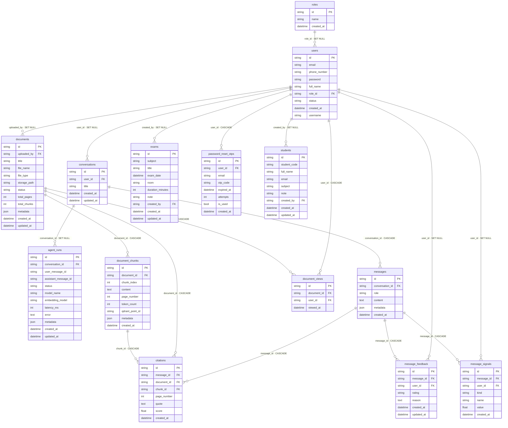

# ERD — Sơ đồ quan hệ Database (C2-App-142)

_Sinh tự động từ DB PostgreSQL thực tế bằng `scripts/generate_erd.py` — 14 bảng, 18 khóa ngoại._

> Xem trực quan: mở file này trong VS Code (extension *Markdown Preview Mermaid*) hoặc dán khối mermaid vào https://mermaid.live . Trên PostgreSQL: pgAdmin → chuột phải database → **ERD For Database**.

## Danh sách khóa ngoại

| Bảng nguồn | Cột | → Bảng đích | ON DELETE |
|---|---|---|---|
| agent_runs | conversation_id | conversations | SET NULL |
| citations | chunk_id | document_chunks | CASCADE |
| citations | document_id | documents | CASCADE |
| citations | message_id | messages | CASCADE |
| conversations | user_id | users | SET NULL |
| document_chunks | document_id | documents | CASCADE |
| document_views | document_id | documents | CASCADE |
| document_views | user_id | users | CASCADE |
| documents | uploaded_by | users | SET NULL |
| exams | created_by | users | SET NULL |
| message_feedback | message_id | messages | CASCADE |
| message_feedback | user_id | users | SET NULL |
| message_signals | message_id | messages | CASCADE |
| message_signals | user_id | users | SET NULL |
| messages | conversation_id | conversations | CASCADE |
| password_reset_otps | user_id | users | CASCADE |
| students | created_by | users | SET NULL |
| users | role_id | roles | SET NULL |
